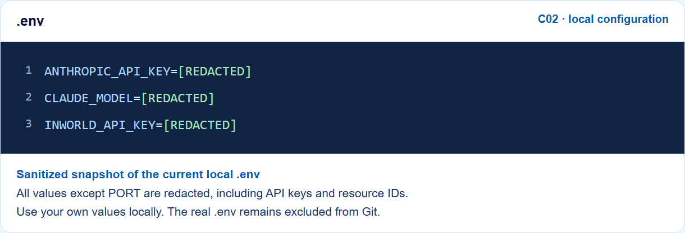

# Lesson C02 — Manual tool loop vs. Managed Agents

Compare two real Claude API flows using the same local `reserveStock` handler. In the manual path, your host drives model calls and keeps `messages[]`. In the managed path, the session drives iteration and retains its event history. **The host executes the inventory effect in both paths.**

## What students learn

1. Choose between Messages API and Managed Agents by identifying who drives iteration and retains history.
2. Treat model tool requests as input to a host operation, rather than proof that an effect happened.
3. Correlate manual `tool_result` records with `tool_use_id` and managed results with `custom_tool_use_id`.
4. Validate quantities and stock before changing host state.
5. Open the managed stream before sending the initial prompt; distinguish it from browser SSE.
6. Explain partial failure using tool results and stock evidence rather than a model summary.

## Prerequisites

- Node.js **24 or newer** and npm.
- An Anthropic API key with access to the configured model.
- Managed Agents access for the managed path. The manual path does not require a managed agent or environment.

## Configure .env

From the application folder containing `package.json`:

```powershell
npm install
if (!(Test-Path .env)) { Copy-Item .env.example .env }
```

Open `.env` in your editor. Preserve an existing file and use the exact filename `.env`, not `.env.txt`.

```dotenv
ANTHROPIC_API_KEY=your_api_key
CLAUDE_MODEL=claude-opus-5-5
PORT=3000
```

`CLAUDE_MODEL` is the code's configured model choice; select a model available to your workspace. The key remains server-side. Restart after editing `.env`. Keep real credentials out of `.env.example`, which is committed for students.

### Sanitized snapshot of the current local configuration



This image is rendered from a sanitized copy of the current local `.env`. All values except `PORT`, including resource IDs and any teaching-service credentials, are replaced **before rendering**. Extra teaching variables in an existing file are not required by the application. `[REDACTED]` is a documentation label, not a usable configuration value.

## Create or reuse the managed resources

If compatible resources do not already exist:

```powershell
npm run managed:setup
```

[src/managed-setup.ts](src/managed-setup.ts) creates a cloud environment, then an agent that registers `reserveStock` as a custom tool. It saves the returned IDs in `.managed-ids.json`. Each setup invocation creates new resources; reuse the saved IDs for later runs. Creating an environment configuration does not establish that a command ran in a cloud container.

To select existing resources instead, set both overrides in `.env`:

```dotenv
MANAGED_AGENT_ID=your_agent_id
MANAGED_ENVIRONMENT_ID=your_environment_id
```

The agent must expose the expected `reserveStock` custom tool. [src/shared.ts](src/shared.ts) gives these environment values priority over the saved file. **C02 uses `MANAGED_AGENT_ID` and `MANAGED_ENVIRONMENT_ID`, rather than C01's `CLAUDE_MANAGED_*` names.** Both `.env` and `.managed-ids.json` remain excluded from Git.

## Run the application

```powershell
npm start
```

`npm run dev` is equivalent. Wait for the ready address, then open `http://127.0.0.1:3000`. Use the configured `PORT` if different. C01 also defaults to 3000, so stop C01 or choose another port before running both applications.

Local pages:

| Page | Address after the server starts |
|---|---|
| Comparison lab | `http://127.0.0.1:3000/` |
| Learning goals | `http://127.0.0.1:3000/guide.html#learning` |
| Setup and run instructions | `http://127.0.0.1:3000/guide.html#run-guide` |
| Architecture and prerequisites | `http://127.0.0.1:3000/architecture.html` |
| Code walkthrough | `http://127.0.0.1:3000/architecture.html#walkthrough` |

1. Select **Happy path** and click **Run both**, or use the individual run buttons.
2. Follow the two timelines. Run both executes manual first, then managed, resetting the seed for each flow.
3. Inspect the real tool results and stock table. Reserving two mugs and one hoodie should leave **10 mugs, 2 hoodies, and 0 lamps**.
4. Try **Out of stock** and **Partial failure**. Failed calls do not subtract stock; earlier successful calls are not automatically rolled back.
5. Keep the terminal open while using the app. **Ctrl+C** stops the local server.

Both flows use the real Claude API and can incur charges. A managed run creates a new remote session. Navigating away does not interrupt remote work; this sample has no interrupt control or general run deadline. Avoid replaying an uncertain reservation. The browser closes a dropped SSE connection instead of automatically reconnecting and starting a second run.

## Follow the code

| Responsibility | Actual source |
|---|---|
| Agent/environment creation and saved IDs | [src/managed-setup.ts](src/managed-setup.ts), [src/shared.ts](src/shared.ts) |
| Manual model loop and local history | [src/flows/manual.ts](src/flows/manual.ts) |
| Managed session and custom-tool result correlation | [src/flows/managed.ts](src/flows/managed.ts) |
| Schema, host validation, reservation effect, seeded stock | [src/inventory.ts](src/inventory.ts) |
| Local routes and browser SSE | [src/server.ts](src/server.ts) |
| Comparison controls and evidence rendering | [public/lab.js](public/lab.js) |
| Student pages and shared navigation/theme | [public/guide.html](public/guide.html), [public/architecture.html](public/architecture.html), [public/navigation.js](public/navigation.js) |

The architecture page contains four prerequisite steps and nine runtime steps, with actual source excerpts and explanations. The two editable UML images follow each protocol separately.

## Terminal versions and verification

```powershell
npm run manual
npm run managed
npm run cli
npm test
```

The managed command needs configured resources first. `npm test` runs the TypeScript check; it does not create resources or exercise the provider. The browser verification script can separately run fixtures or actual provider calls; its observations are stored in the ignored `teaching-material` folder and label the evidence source.

## Scope and interpretation

- Inventory is seeded, shared process memory. Use one comparison run at a time. This is not a durable or multi-tenant inventory service.
- A Done badge means the runner returned a done record; it does not guarantee that every requested reservation succeeded. Inspect tool results and stop reasons.
- The managed counter uses `history.data.length` from the first returned event-history page. It is not an automatically paginated total or a durable business audit.
- There is no production idempotency ledger, multi-call transaction rollback, remote cancellation workflow, or automatic archival in this sample.
- The server binds to `127.0.0.1` for a trusted local user.

## Troubleshooting

| Symptom | Check |
|---|---|
| Invalid API key | Put your own key in `.env`, not `.env.example`, and restart. |
| Managed resources missing | Run setup once or set both compatible resource overrides. |
| Model rejected | Set a model supported by your workspace and use a compatible managed agent. |
| Port already in use | Stop the other app or change `PORT`. |
| Lost local connection | Check the terminal and inspect the previous outcome before retrying. |

## Documentation maintenance

Application execution needs only npm dependencies. Optional asset generation uses Python; screenshot/export tasks additionally need Playwright and Chromium:

```powershell
python scripts/build-student-pages.py
python scripts/build-sequence-diagrams.py
python scripts/capture-env-example.py
python scripts/verify-student-pages.py
```

The documentation builder reads the actual TypeScript and browser source. The screenshot script redacts configuration before passing any text to the local browser. Existing videos, presentations, production scripts, dependencies, local output, and real configuration remain outside this code-only repository through `.gitignore`.
